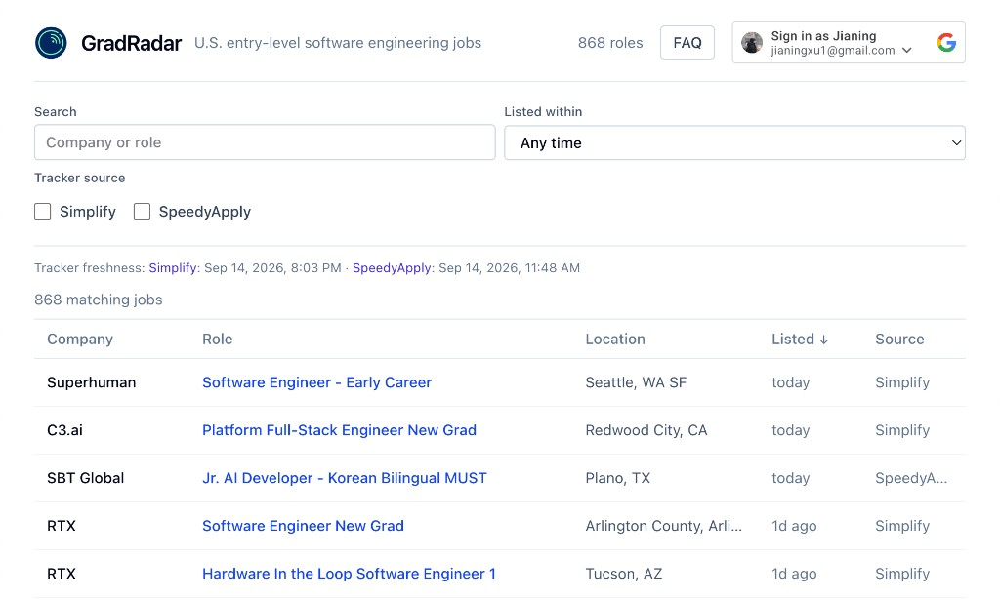
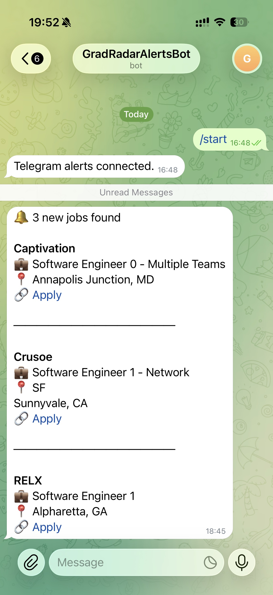

  <h1>GradRadar</h1>
  

    GradRadar helps U.S. new grads find software engineering roles early by bringing the newest listings from multiple job trackers into one place, with opt-in Telegram notifications for new matches.
  

  
  

    <a href="https://gradradar-web.vercel.app">Live website</a>  
  

  
  
Opt-in Telegram notifications for new job matches.

## Why I built this

As a CS student looking for new-grad positions, I kept hearing the same advice: apply early. Once a role has thousands of applications, getting an interview is hard; so applying early is essential.

I built GradRadar so I could check one place for the latest, deduplicated new grad job listings instead of manually refreshing several trackers. It also sends opt-in Telegram alerts, so we don't miss an opportunity because we saw it too late.

## Tech stack

- **Frontend:** React, TypeScript, Vite, Tailwind CSS
- **Backend:** Python, FastAPI, SQLAlchemy, Pydantic
- **Data and jobs:** PostgreSQL/Supabase, GitHub API, HTTPX, APScheduler
- **Testing:** pytest, respx, Vitest, Testing Library

## What it does

- Ingests new-grad SWE listings from the [SpeedyApply](https://github.com/speedyapply/2027-SWE-College-Jobs) and [Simplify](https://github.com/SimplifyJobs/New-Grad-Positions) GitHub trackers.
- Keeps clearly U.S.-eligible roles, normalizes application URLs, and uses those URLs to deduplicate the same job across sources.
- Stores the result and displays it in a searchable, filterable website with the original application link and tracker source.
- Sends opt-in private Telegram notifications to signed-in users when new jobs are found.
  Notifications begin only after connection confirmation and never backfill old jobs.

## Roadmap

- [x] Import new-grad job listings from the SpeedyApply and Simplify GitHub trackers.
- [x] Keep software engineering jobs that match new-grad criteria and have clearly U.S.-eligible locations.
- [x] Normalize application links and show duplicate jobs once while retaining their tracker sources.
- [x] Build a feed to search by company or title, filter by location, remote status, source, or listing date, sort results, and browse pages; provide a read-only API.
- [x] Run scheduled ingestion and monitor the production service and database.
- [x] Add Google sign-in for user accounts.
- [x] Send opt-in Telegram alerts after users connect their accounts; support disconnecting, retries, and duplicate-safe delivery.
- [x] Ingest jobs directly from Greenhouse, Ashby, and Lever company boards; let admins manage boards and job filters, and show source-specific application links and sync status.
- [ ] Add support for more company job board platforms.
- [ ] Let admins add company board sources from the app.
- [ ] Add an in-app feedback button so users can suggest improvements.
